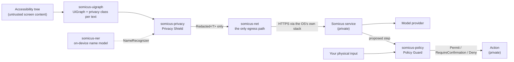

# Somicus trust layer

The auditable privacy and safety boundary of Somicus: on-device redaction, a type-enforced egress path, and a local
policy guard that decides what an AI agent may do on your computer.

[](https://github.com/Brok3nnn/somicus-trust-layer/actions/workflows/ci.yml)
[](LICENSE)
[](rust-toolchain.toml)

## What Somicus is

Somicus is a desktop AI co-pilot. With your consent it reads the window in front of you through the operating
system's accessibility APIs, and then answers your question, shows you where to click, or does the steps itself. The
full product (the desktop app, the backend and the agent runtime) is proprietary and **not open source**; see
[landingsomicus.vercel.app](https://landingsomicus.vercel.app).

## What this repository contains, and why it is open

An agent that can read your screen and click for you has to be trusted with two things: what it sends off your
device, and what it does on it. This repository is the code that enforces both, published so that anyone can audit it:

- **Privacy**: personal data in screen text is found and pseudonymized on the device before anything leaves it.
- **Egress**: one request function, whose body must be a `Redacted<T>`: an un-redacted body does not compile, and the
  only ways around the brand are three named, greppable functions. The URL and the credential headers are plain
  strings the caller chooses. No crate but `somicus-net` opens a connection: Clippy's `disallowed-methods` rejects
  socket, DNS and process calls everywhere else, and `deny.toml` bans other HTTP clients; CI runs both.
- **Safety**: every step the agent proposes passes local, deterministic rules that a model or a compromised server
  cannot override.

It is a Cargo workspace of six library crates and one evaluation suite, extracted from the private Somicus monorepo
with their history of decisions ([ADRs](docs/adr/README.md)).

## Architecture

The screen data path, from the accessibility tree to the model provider and back to an action:



Pseudonyms such as `⟦PERSON_1⟧` go out; the model's answer is rehydrated on the device. Diagnostics from every crate
pass through `somicus-telemetry`, which admits only allow-listed labels and counts. More in
[docs/architecture.md](docs/architecture.md).

## How each crate works

### `somicus-privacy`: the Privacy Shield and `Redacted<T>`

[`PrivacyShield`](crates/somicus-privacy/src/shield/mod.rs) classifies and redacts texts, screen digests and whole UI
graphs. [Recognizers](crates/somicus-privacy/src/recognizers/patterns.rs) find e-mail addresses, phone numbers,
payment cards (Luhn), IBANs (mod 97), national IDs with checksums, secrets and addresses; [rule-based name
recognition](crates/somicus-privacy/src/recognizers/names.rs) covers English, German and Hungarian. Findings become
session tokens in a [`TokenVault`](crates/somicus-privacy/src/vault.rs) that lives only in memory and is zeroized on
drop.

The output is branded. [`Redacted<T>`](crates/somicus-privacy/src/redacted.rs) has a private constructor, no
`From<T>`, no `Deserialize`, and a `Debug` that prints `Redacted(…)`:

```rust
pub struct Redacted<T> {
    inner: T,
}

impl<T> Redacted<T> {
    /// Brands Privacy Shield output. Only this crate can call it.
    pub(crate) const fn new(inner: T) -> Self { Self { inner } }

    /// Brands protocol framing, identifiers or credentials that carry no screen or user content.
    pub const fn without_content(value: T) -> Self { Self { inner: value } }
    // …
}
```

`compile_fail` doc tests on the type show that `Redacted::new(raw)`, `raw.into()` and `serde_json::from_str` do not
compile outside the crate. The only ways in are the shield, the named `without_content` and `account_data`
constructors, and `map` on an already branded value: every one of them is a greppable audit point.

### `somicus-net`: the only egress path

[`send`](crates/somicus-net/src/service/mod.rs) is the one request function, and its body type is the brand:

```rust
pub struct ServiceRequest<'a> {
    pub method: Method,
    pub url: &'a str,
    /// The JSON body, if any.
    pub body: Option<Redacted<Vec<u8>>>,
    pub authorization: Option<&'a str>,
    pub dpop: Option<&'a str>,
}

pub async fn send(request: ServiceRequest<'_>) -> Result<ServiceResponse, NetError>
```

HTTPS runs inside the process through each system's own stack ([`src/native/`](crates/somicus-net/src/native)):
WinHTTP on Windows, `NSURLSession` on macOS, the distribution's libcurl on Linux. Every backend keeps the same rules
([ADR-0049](docs/adr/ADR-0049-native-https-transports.md)): plain HTTP only to loopback, TLS 1.2+, no cookies or stored
credentials, no redirects, answers cancelled past 8 MiB while they stream, a 25-second budget, and nothing sent when
`SSLKEYLOGFILE` is set. A [shared conformance suite](crates/somicus-net/src/native/conformance.rs) pins the rules for
the macOS and Linux backends; the WinHTTP backend has its own tests, which have not run on Windows yet. Two bodiless
requests are documented exceptions: the [website icon](crates/somicus-net/src/site_icon.rs) and the [hash-pinned
download](crates/somicus-net/src/pinned_file.rs) of the name model. No other crate may open a connection: Clippy's
`disallowed-methods` ([`clippy.toml`](clippy.toml)) rejects the standard library's and Tokio's socket, DNS and process
calls outside `somicus-net`, and [`deny.toml`](deny.toml) bans every other HTTP or WebSocket client crate and keeps
`curl` and the system stacks' bindings in `somicus-net`.

### `somicus-policy`: the local Policy Guard

[`PolicyGuard::evaluate_action`](crates/somicus-policy/src/guard.rs) decides every step the agent proposes:

```rust
pub enum PolicyDecision {
    /// Action is permitted to proceed without user confirmation.
    Permit,
    /// Action requires physical user confirmation before execution.
    RequireConfirmation { action_hash: ActionHash, risk: RiskClass },
    /// Action is strictly prohibited by policy.
    Deny { reason: String },
}
```

- **Risk classes** R0 (observe) to R5 (prohibited) from a whole-word [label lexicon](crates/somicus-policy/src/risk/lexicon.rs)
  in five languages and floors per action kind; a model's estimate can raise a class, never lower it.
- **Hard invariants**: R5 is always denied, nothing runs at autonomy L0, and a small [built-in deny
  list](crates/somicus-policy/src/bundle.rs) (18 names of password managers, banking and brokerage apps and security
  settings, matched as whole words) holds under every policy.
- **Trusted intent**: the [`IntentVerifier`](crates/somicus-policy/src/verifier.rs) accepts a confirmation only as
  physical input inside the confirm control within 1 s, bound to the action's hash, once; synthetic events are
  rejected.
- **Value, key and transfer rules**: Somicus may type only [values with a known provenance](crates/somicus-policy/src/typed/mod.rs)
  (the person's words, the task's screens, [checked calculations](crates/somicus-policy/src/numbers/mod.rs)), press
  only [allow-listed keys](crates/somicus-policy/src/keys.rs), and move clipboard content only under
  [transfer rules](crates/somicus-policy/src/transfer.rs).
- **Signed bundles**: organisations tighten the policy with an Ed25519 [JWS envelope](crates/somicus-policy/src/envelope.rs)
  verified against pinned keys before parsing; a bundle can never loosen the invariants.

### `somicus-ner`: on-device name recognition

Rules alone find few names, so [`NameModel`](crates/somicus-ner/src/recognizer.rs) runs `dslim/distilbert-NER`
(Apache-2.0) on the CPU with candle, behind the shield's trait:

```rust
pub trait NameRecognizer: Send + Sync {
    fn find_names(&self, texts: &[&str], deadline: Instant) -> Vec<Option<Vec<Range<usize>>>>;
}
```

The weights are **not** in this repository. Each file is accepted only with the exact length and SHA-256 compiled into
[`pins.rs`](crates/somicus-ner/src/pins.rs), and the bytes that were hashed are the bytes that are parsed (no memory
map, no pickle). The [tokenizer](crates/somicus-ner/src/tokenizer.rs) and the
[DistilBERT forward pass](crates/somicus-ner/src/distilbert.rs) are written here; the model only sees what the rules
left, can only add redactions, and works within a per-turn deadline.

### `somicus-uigraph` and `somicus-telemetry`

[`somicus-uigraph`](crates/somicus-uigraph/README.md) holds the platform-neutral screen model the shield redacts,
including each text's [`PrivacyClass`](crates/somicus-uigraph/src/privacy.rs).
[`somicus-telemetry`](crates/somicus-telemetry/README.md) is the only way the crates record spans and events: field
names and value kinds are [allow-listed](crates/somicus-telemetry/src/field.rs) at compile time and again by a
run-time layer, so screen text cannot reach a log.

## Threat model

The trust layer assumes the screen, the model and even the Somicus backend may be hostile. In summary:

| Threat | Mitigation | Residual |
|---|---|---|
| Personal data reaches the model provider | Privacy Shield on every outgoing text; `send` accepts only `Redacted<T>` | Medium: recall is not 100 % |
| A compromised backend or model proposes a harmful step | Local risk floors, autonomy cap, deny list, R5 never, confirmations bound to physical input | Low–Medium |
| Prompt injection through screen text | Provenance rules for typed values, key allow-list, transfer rules | Medium: most injection defences live in the private runtime |
| A forged or older policy bundle | Pinned Ed25519 keys, JWS checked before parsing, forward-only versions, deny-list floor | Low |
| The transport leaks or is redirected | One audited stack per OS, shared conformance tests, no other HTTP client allowed | Low |
| Diagnostics capture content | Compile-time and run-time field allow-list | Low |

Full model, with trust boundaries and residual risks: [docs/security/threat-model.md](docs/security/threat-model.md).
See also [privacy](docs/security/privacy.md) and [AI safety](docs/security/ai-safety.md).

## Design decisions

| ADR | Decision |
|---|---|
| [ADR-0013](docs/adr/ADR-0013-autonomy-levels-and-risk-classes.md) | Autonomy levels L0–L3 and risk classes R0–R5 |
| [ADR-0014](docs/adr/ADR-0014-on-device-redaction.md) | On-device redaction before any egress |
| [ADR-0027](docs/adr/ADR-0027-website-icons.md) | The website icon, a request without a redacted body |
| [ADR-0040](docs/adr/ADR-0040-confirmations-the-person-can-switch-off.md) | Confirmations on by default; only the person can switch them off |
| [ADR-0041](docs/adr/ADR-0041-policy-as-rust-rules-with-signed-bundles.md) | Policy as Rust rules with signed bundles, not a policy engine |
| [ADR-0042](docs/adr/ADR-0042-on-device-name-recognition.md) | On-device name recognition with a hash-pinned DistilBERT |
| [ADR-0049](docs/adr/ADR-0049-native-https-transports.md) | HTTPS inside the process through each OS's own stack |
| [ADR-0052](docs/adr/ADR-0052-delivering-signed-policy-bundles.md) | JWS envelopes, pinned keys and a deny-list floor for policy bundles |

## Getting started

Requirements: `rustup` (the toolchain, Rust 1.99.1, is pinned in [`rust-toolchain.toml`](rust-toolchain.toml)); on
Linux, the system libcurl (`libcurl4-openssl-dev` on Debian and Ubuntu).

```bash
cargo test                                   # 250 tests, offline; 15 are ignored (see below)
cargo clippy --all-targets -- -D warnings
cargo fmt --all --check
```

The ignored tests need things `cargo test` must not assume: three reach the public internet, nine need the name-model
files, and three are doc examples that are not meant to run.

### Running the privacy eval (R-suite)

```bash
# Rules only: part of `cargo test`; --nocapture prints recall, precision and latency.
cargo test -p somicus-privacy-evals -- --nocapture

# With the name model: fetch and convert the pinned files first (crates/somicus-ner/README.md).
SOMICUS_NAME_MODEL_DIR=$PWD/models \
  cargo test --release -p somicus-privacy-evals --test r_suite_v1_model -- --ignored --test-threads 1 --nocapture
```

On 430 labelled synthetic samples, the rules alone find 100 % of the identifiers (cards, IBANs, national IDs) and 14 %
of the person names; with the name model, 95.2 % of the names. Details: [evals/privacy](evals/privacy/README.md).

## Project structure

```text
.
├── crates/
│   ├── somicus-privacy/     Privacy Shield, token vault, Redacted<T>
│   ├── somicus-net/         the only egress path: send, Downloader, site icon
│   ├── somicus-policy/      Policy Guard, risk, trusted intent, signed bundles
│   ├── somicus-ner/         hash-pinned DistilBERT name recognizer (+ convert_name_model example)
│   ├── somicus-uigraph/     platform-neutral UI Graph types
│   └── somicus-telemetry/   allow-listed, content-free diagnostics
├── evals/privacy/           R-suite: recall, precision and latency on synthetic screens
├── docs/
│   ├── architecture.md
│   ├── security/            threat model, privacy, AI safety
│   └── adr/                 architecture decision records
├── clippy.toml              lint settings: no socket, DNS or process calls outside somicus-net
├── deny.toml                dependency policy (cargo-deny)
└── .config/nextest.toml     optional cargo-nextest settings
```

## Status and limitations

- **In development.** This is the trust layer of a product that is still in development, published as version 1.0.0
  of this repository, not of Somicus.
- **Only part of the product is public.** Screen capture, actuation, the desktop app, the agent runtime and the backend
  are private, so the crates are libraries without their callers here. Claims about how the product uses them are
  limited to what the code and tests in this repository show.
- **Recall is not 100 %.** Without the name model, most person names pass through unredacted.
- **The name model files are not included**; the model-backed tests and eval are opt-in.
- **Platform coverage.** CI runs the tests on Linux and macOS, where they exercise libcurl and `NSURLSession`, and
  Clippy on Windows, where the WinHTTP backend and its Windows-only tests compile; those tests have not been run.
- The escape hatches `Redacted::without_content`, `Redacted::account_data` and `Redacted::map` exist by design; the
  product's call sites of them are not in this repository.

## Licence

Licensed under the [Apache License, Version 2.0](LICENSE). See [NOTICE](NOTICE).

## About

Built by [Balint Vitan](https://github.com/Brok3nnn), with AI-assisted tooling.
