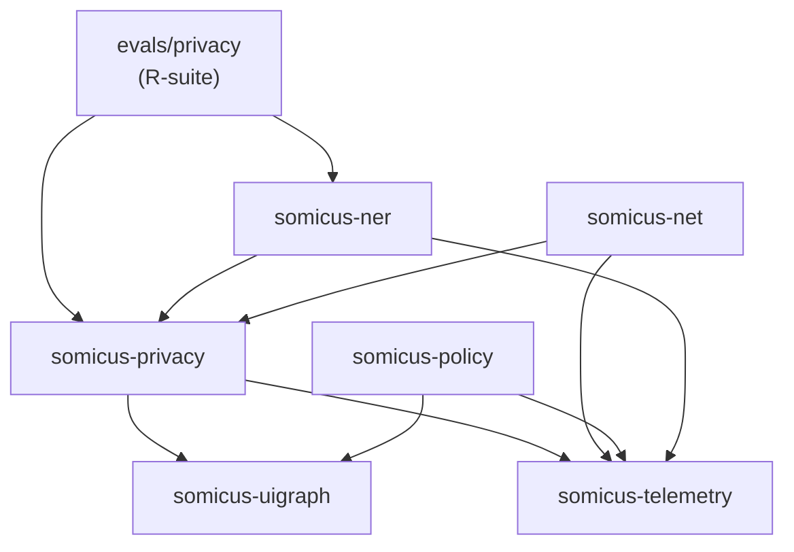

# Architecture of the trust layer

Somicus is a desktop AI agent. With the person's consent it reads the window in front of them through the operating
system's accessibility APIs, sends a pseudonymized description of it to a language model, and answers, points at the
next click, or performs the steps itself. This repository holds the part of the desktop core that decides **what may
leave the device** and **what Somicus may do**. Capture, actuation, the desktop app, the agent runtime and the backend
are private and not included.

## Principles

1. **Minimise at the source.** Screen text is classified and pseudonymized on the device; raw personal data never
   needs to leave it. The model sees `⟦PERSON_1⟧`, and the answer is rehydrated locally.
2. **One egress path, enforced by types and lints.** Only `somicus-net` opens connections (Clippy's
   `disallowed-methods` and `deny.toml`, both run in CI), and its request body type is `Redacted<T>`, which only the
   Privacy Shield (or a named, greppable escape hatch) can produce. The URL and the credential headers are not branded.
3. **Deterministic gating, independent of the model.** Whether a step may run is decided by local Rust rules: risk
   floors a model can only raise, an autonomy cap, an app deny list, value and key rules, and confirmations verified as
   physical input. A compromised server or a manipulated model can propose; it cannot authorise.
4. **Organisations can only tighten.** A signed policy bundle can lower the autonomy cap, deny apps or require
   confirmations; it can never loosen the compiled invariants.
5. **Content-free diagnostics.** Spans and events carry only allow-listed labels and counts.

## The screen data path

```mermaid
flowchart LR
    ax["Accessibility tree<br/>(other apps: untrusted)"] --> graph["somicus-uigraph<br/>UiGraph + PrivacyClass"]
    graph --> shield["somicus-privacy<br/>Privacy Shield"]
    ner["somicus-ner<br/>name model (optional)"] -. NameRecognizer .-> shield
    shield -->|"Redacted&lt;T&gt;"| net["somicus-net<br/>send()"]
    net -->|"HTTPS, system stack"| svc["Somicus service<br/>(private)"]
    svc --> llm["Model provider"]
    svc -->|"proposed step"| guard["somicus-policy<br/>Policy Guard"]
    input["Physical input<br/>(clicks, keys)"] --> guard
    guard -->|"Permit / RequireConfirmation / Deny"| act["Actuation<br/>(private)"]
    shield -. "rehydrate (on device)" .-> ui["What the person sees"]
```

1. The capture (private) turns the accessibility tree into a `UiGraph`; every text carries a `PrivacyClass` (public
   label, content, personal, secret).
2. The `PrivacyShield` redacts the graph, the screen digest or a single text: recognizers with checksums, rule-based
   names, and optionally the name model of `somicus-ner` within a per-turn deadline. Findings become session tokens
   held in a zeroized `TokenVault`.
3. The branded result is serialized (`Redacted::to_json_bytes`) and sent by `somicus_net::send` through WinHTTP,
   `NSURLSession` or libcurl, under the rules of ADR-0049.
4. A step the model proposes comes back to the device, where `PolicyGuard::evaluate_action` decides: permit, require a
   confirmation bound to the action's hash, or deny. The `IntentVerifier` accepts a confirmation only from physical
   input inside the confirm control.
5. `somicus-telemetry` records what happened as labels and counts, never content.

## Crates



| Crate | Role |
|---|---|
| [`somicus-privacy`](../crates/somicus-privacy/README.md) | Privacy Shield, token vault, the `Redacted<T>` brand, the `NameRecognizer` seam |
| [`somicus-net`](../crates/somicus-net/README.md) | The only egress path: `send`, the pinned-file `Downloader`, the site-icon request |
| [`somicus-policy`](../crates/somicus-policy/README.md) | Policy Guard: risk, autonomy, trusted intent, value/key/transfer rules, signed bundles |
| [`somicus-ner`](../crates/somicus-ner/README.md) | Hash-pinned DistilBERT person-name recognizer on candle |
| [`somicus-uigraph`](../crates/somicus-uigraph/README.md) | Platform-neutral UI Graph types the shield and the guard read |
| [`somicus-telemetry`](../crates/somicus-telemetry/README.md) | Allow-listed, content-free spans and events |
| [`evals/privacy`](../evals/privacy/README.md) | R-suite: recall, precision and latency of the shield |

## Edge and cloud

| On the device (this repository) | In the private product |
|---|---|
| Classification and redaction of every outgoing text | Capture through the accessibility APIs, actuation |
| The token vault and rehydration | The agent runtime and its prompts |
| The egress transports and their limits | The model gateway and the backend |
| Risk floors, the autonomy cap, the deny list, confirmations | Server-side checks (injection check, consequence gate) |
| Verification of signed policy bundles | Signing and delivering bundles |

See the [threat model](security/threat-model.md), [privacy](security/privacy.md),
[AI safety](security/ai-safety.md) and the [decision records](adr/README.md).
