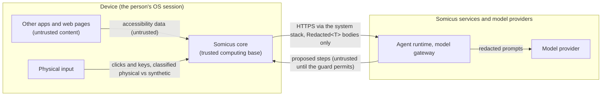

# Threat model of the trust layer

This is the part of the Somicus threat model that the code in this repository enforces. The product's full model also
covers identity, the backend, the desktop shell and operations, which are not here.

## Objectives

1. **Confidentiality of screen content.** Personal and confidential data on the screen does not leave the device in
   clear text, and is not recorded in diagnostics.
2. **Integrity of actions.** Somicus never performs a step that the person and the policy did not authorise, even if
   the backend, a model or the screen is malicious.
3. **Bounded egress.** The device talks only through one audited path, with fixed transport rules.

The agent holds powerful operating-system permissions (accessibility, input injection), so "Somicus as an attack
vector" (a compromised backend, prompt injection) is treated as seriously as attacks on Somicus itself.

## Assets

| Asset | Where it lives | Protected by |
|---|---|---|
| Screen content (labels, static text, window titles) | Device memory during a turn | Privacy Shield before egress; never logged |
| The token vault (pseudonym ↔ original) | Device memory only | Never sent; zeroized on drop |
| The person's confirmation setting and the active policy bundle | Device | Policy Guard invariants; signature checks |
| The name model files | Device disk | Length and SHA-256 pins, checked at every load |

## Trust boundaries

Every arrow into the core is untrusted: screen text may contain instructions, and a proposed step may come from a
compromised service. Everything out of the core is redacted and bounded.

## Threats and mitigations

| # | Threat | Scenario | Mitigations in this repository | Residual |
|---|---|---|---|---|
| T1 | Information disclosure | Personal data on screen reaches the model provider | Privacy Shield on every outgoing text (`somicus-privacy`); `send` accepts only `Redacted<T>`; `compile_fail` examples prove raw values do not compile | Medium: recall is not 100 % (R-suite: names 14 % with rules only, 95 % with the model) |
| T2 | Elevation | A compromised backend or model proposes a harmful step | Local risk floors a model can only raise, autonomy cap, R5 always denied, built-in deny list, nothing at L0, confirmations bound to the action hash (`somicus-policy`) | Low–Medium; higher for a person who switched confirmations off (T6) |
| T3 | Tampering (prompt injection) | Text on screen instructs the agent | Screen data is data: the guard's value rules allow typing only what came from the person's words, the task's screens or a checked calculation; key allow-list; transfer rules | Medium; most injection defences run in the private agent runtime |
| T4 | Spoofing | A forged or replayed confirmation, or one from injected input | `IntentVerifier`: physical input inside the control's bounds within 1 s, bound to the action hash, replay refused, synthetic events rejected | Low; a local process able to post events as the HID system (device compromise) passes as physical |
| T5 | Tampering | A forged, older or foreign policy bundle loosens the policy | JWS with pinned Ed25519 keys checked before parsing, strict payload, forward-only versions, workspace binding, first-install validity, deny-list floor (ADR-0052) | Low |
| T6 | Elevation | With confirmations off, injected text or a model mistake makes Somicus send, delete or pay | Only the person can switch them off; organisations can force them on; every deterministic rule still applies (ADR-0040) | Medium for that person (a deliberate trade-off) |
| T7 | Information disclosure / tampering | The transport leaks or is redirected: plain HTTP, redirects, cookies, unbounded answers, a TLS key log | One stack per system inside the process; the rules of ADR-0049, pinned by shared conformance tests; `SSLKEYLOGFILE` stops every request; `deny.toml` bans other HTTP clients | Low; a process running as the person can change the account's proxy or roots (device compromise) |
| T8 | Information disclosure | A span or event carries screen text, a token or a path | `somicus-telemetry`: field names and kinds allow-listed at compile time and by a run-time layer; release builds install nothing | Low |
| T9 | Tampering | A swapped or corrupted name-model file | Length and SHA-256 pins compiled in; the checked bytes are the parsed bytes; safetensors cannot run code | Low |
| T10 | Information disclosure | The two bodiless requests (site icon, model download) leak data | Icon: public hosts only, the page's own host, no cookies, bounded image (ADR-0027). Download: pinned URL and hash, no query, cookies or credentials, no redirects | Low |
| T11 | Information disclosure | Malware on the device reads memory | Out of scope: device compromise. The vault lives only in memory and is zeroized on drop | Medium |

## Residual risks and limits

- Recall is never 100 %. The rules alone find 14 % of person names on R-suite v1; with the name model, 95 %. A name the
  shield misses leaves the device in clear text.
- `Redacted::without_content`, `Redacted::account_data` and `Redacted::map` are escape hatches; their call sites in the
  product are reviewed, but this repository cannot show those call sites.
- The URL and headers of a request are not branded; they are chosen by the caller (service endpoints and tokens).
- The WinHTTP backend's Windows-only tests have not been run yet.
- "Physical" means what the operating system reports about an event's source; a privileged local process can forge
  it. The defence is the OS's own protection of event posting.
